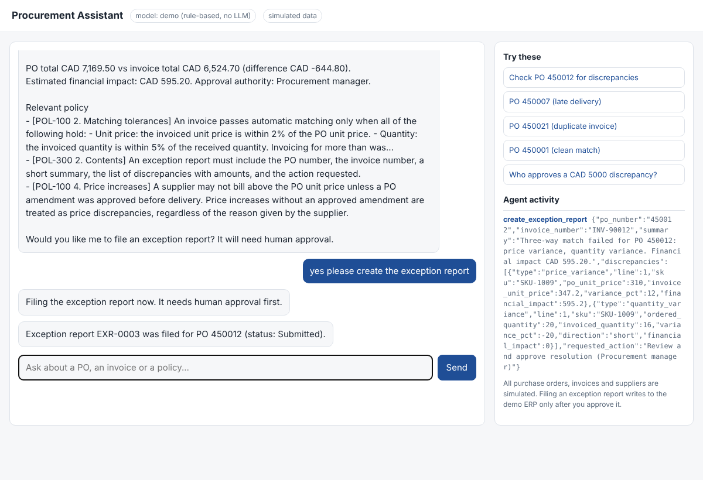
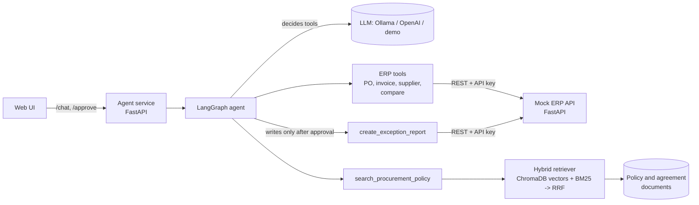

# Procurement Assistant: Agentic RAG over (Simulated) ERP Data

An AI assistant for accounts-payable and purchasing teams. It answers questions from procurement
policies with **RAG**, and it works with business data through **controlled tools** that call an ERP-style
REST API. Anything that *writes* to the ERP pauses for **human approval** first.

> **All data is simulated.** Suppliers, purchase orders, invoices, policies and supplier agreements are
> fictional and generated for this demo. Nothing here is based on a real company or real documents.



## What it does

Ask something like:

> *Can you check the status of purchase order 450012, compare it with the supplier invoice, and tell me
> whether there are any discrepancies?*

The agent then:

1. Fetches the purchase order and the invoice from the ERP API.
2. Runs a deterministic three-way match (price, quantity, total, late delivery, duplicate invoices).
3. Searches the procurement policies (hybrid RAG) for the rules that apply.
4. Explains the discrepancies with amounts, the required approver, and **policy citations** such as
   `[POL-100 2. Matching tolerances]`.
5. Offers to file an exception report. If you accept, the graph **pauses** and shows the exact record to
   be written. Nothing is written until a person clicks *Approve*.

## Architecture



| Piece | What it is |
|---|---|
| `erp_api/` | Separate FastAPI service standing in for an enterprise system. API-key protected. Seeded with simulated data. |
| `agent_service/rag/` | Heading-aware chunking, pluggable embeddings, ChromaDB vector search, BM25 keyword search, Reciprocal Rank Fusion, metadata filter, citations. |
| `agent_service/matching.py` | Deterministic three-way match and approval-authority rules (the LLM does not do money math). |
| `agent_service/tools.py` | The six tools the agent can call. |
| `agent_service/guardrails.py` | Deterministic checks around the model: forced policy search, citation verification, the true outcome of a filing. |
| `agent_service/agent.py` | LangGraph graph: `agent -> tools -> approval -> agent`, with `interrupt()` before write actions. |
| `agent_service/main.py` | Chat API (`/chat`, `/approve`, `/health`) and the web UI. |
| `data/policies/` | Fictional policies (POL-100..500) and two supplier agreements. |

### Design decisions

- **Tools for facts, LLM for judgment.** Price and quantity variances are computed in Python. The model
  chooses tools, explains results and cites policy.
- **Human-in-the-loop for writes.** `create_exception_report` is gated with LangGraph `interrupt()`.
  The test suite asserts nothing is written before approval and that rejection writes nothing.
- **Hybrid search.** Keyword search (BM25) catches exact terms like "POL-300" or "CAD 5,000"; vector
  search catches paraphrases. Results are merged with Reciprocal Rank Fusion.
- **Guardrails, because models slip.** A model can skip a tool, quote a citation it never retrieved, or misreport
  what just happened. After a failed match the policy search is run if the model skipped it, citations in the
  answer must match what the search returned (others are removed), and the real outcome of a filing is stated.
  Tests use a scripted, misbehaving model to prove each one.
- **Pluggable model.** `LLM_PROVIDER` switches between a local Ollama model, OpenAI, or a no-LLM demo mode.

## Quick start

Requires Python 3.12+.

```bash
python -m venv .venv && source .venv/bin/activate
pip install -r requirements-dev.txt

# terminal 1: mock ERP
uvicorn erp_api.main:app --port 8001

# terminal 2: agent service + UI  (demo mode, no model needed)
LLM_PROVIDER=demo EMBEDDING_BACKEND=hashing uvicorn agent_service.main:app --port 8002
```

Open <http://localhost:8002> and click *Check PO 450012 for discrepancies*.

### Using a real LLM

```bash
# Local, with Ollama (use a tool-calling model: llama3.1 or llama3.2; plain "llama3" cannot call tools)
ollama pull llama3.1
LLM_PROVIDER=ollama OLLAMA_MODEL=llama3.1 uvicorn agent_service.main:app --port 8002

# OpenAI
LLM_PROVIDER=openai OPENAI_API_KEY=sk-... uvicorn agent_service.main:app --port 8002
```

### Real semantic embeddings

```bash
pip install -r requirements-embeddings.txt   # sentence-transformers (downloads a model on first run)
EMBEDDING_BACKEND=auto uvicorn agent_service.main:app --port 8002
```

Without it, a lexical hashing embedder is used. It is fine for tests and demos but is not semantic.

### Docker

```bash
docker compose up --build        # UI at http://localhost:8002
# with real embeddings: docker compose build --build-arg WITH_EMBEDDINGS=true
```

## Tests

```bash
python -m pytest -q      # 49 tests: matching rules, ERP API, chunking, retrieval, agent flow, approval gate, guardrails, HTTP API
```

## Demo data

| PO | Scenario |
|---|---|
| 450012 | Price +12% on line 1 and short quantity (main demo) |
| 450007 | Delivered 6 business days late |
| 450021 | Duplicate invoice (CAD 18,085) |
| 450030 | Price +1%, inside tolerance, so it passes |
| 450001 | Clean match |
| 450044 | Not invoiced yet |

Regenerate with `python scripts/generate_data.py` (fixed seed).

## Limitations (read before relying on this)

- **Simulated data only.** No real SAP/ERP integration. The mock ERP is in-memory and resets on restart.
- **Demo mode is not an LLM.** It is a rule-based planner that exercises the tools, RAG and approval flow
  without a model. Natural-language flexibility needs a real model (`ollama` or `openai`).
- **Retrieval quality is not benchmarked.** Tests check that known questions retrieve the right policy
  sections; there is no RAGAS-style evaluation yet. There is no cross-encoder reranker.
- **No goods-receipt data.** Quantity checks treat the ordered quantity as the received quantity.
- **Thresholds are duplicated in code** (`matching.py`) from the policy documents; a real system would
  source them from governed configuration.
- **No end-user authentication.** The approver's identity is not recorded, and conversation state is
  in memory (`MemorySaver`).

## Possible next steps

RAGAS evaluation of retrieval and answers, a cross-encoder reranker, a persistent checkpointer and
database, SSO for approvers, and an OData-style ERP adapter.
